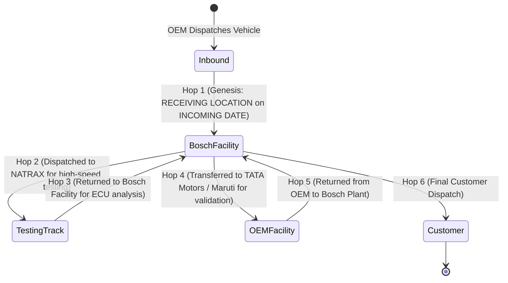

# 3. Vehicle Tracking & Multi-Hop Lifecycle Guide

## Purpose & Company Requirement 1.4
A core requirement of the system is the ability to track vehicles across arbitrary, cyclic sequences of locations and operations:
> *"1 vehicle received at one location, work done in the location, next sent to other location, again come back to start location then sending back to OEM. From OEM again same vehicle came back to my location (consider this type all possible combinations)."*

Additionally, the specification establishes:
> *"RECEIVING LOCATION and INCOMING DATE are start points."*

---

## 1. Genesis Hop Architecture (The Start Point)
When a vehicle is imported or registered in the system:
1. `RECEIVING LOCATION` defines the initial facility destination (e.g., `BOSCH PLANT`, `WORKSHOP`).
2. `INCOMING DATE` defines the initial arrival date.
3. The system automatically creates **Hop #1 (Genesis Hop)**:
   - **Source**: `OEM / Inbound Transit`
   - **Destination**: `RECEIVING LOCATION`
   - **Arrival Date**: `INCOMING DATE`
   - **Purpose**: Initial Vehicle Receipt & Check-in
   - **Status**: `Received`

---

## 2. Multi-Hop Journey State Machine

Vehicles progress through an arbitrary sequence of hops without restriction. Each hop records the transition between two facilities:

### Cyclic Transitions Supported:
1. **Plant &rarr; Track &rarr; Plant**:
   - `BOSCH PLANT` &rarr; `NATRAX` (Track testing)
   - `NATRAX` &rarr; `BOSCH PLANT` (Inspection & return)
2. **Plant &rarr; OEM &rarr; Plant**:
   - `BOSCH PLANT` &rarr; `TATA MOTORS` (OEM review)
   - `TATA MOTORS` &rarr; `BOSCH PLANT` (Second development phase)
3. **Multi-Partner Roundtrips**:
   - `BOSCH PLANT` &rarr; `NATRAX` &rarr; `TATA MOTORS` &rarr; `BOSCH PLANT` &rarr; `CUSTOMER`

---

## 3. How to Log a Movement Hop in the UI

1. Open the vehicle's detail page by searching its **Bosch VIN** (e.g., `CVP_2023_001`) or **OEM ID** (e.g., `EP07116`) in the search bar.
2. Click the **"Log Movement Hop"** button.
3. Fill in the modal fields:
   - **From Location**: Auto-populated with the vehicle's current location.
   - **To Location**: Destination facility (choose from dropdown or type a new hub).
   - **Dispatch Date / Arrival Date**: Relevant dates.
   - **Movement Purpose**: Reason for transfer (e.g., *Dynamic Track Testing*, *OEM Handover*).
   - **Work Done**: Work completed prior to dispatch or planned upon arrival.
   - **DC / Gate Pass**: Delivery Challan or security pass number.
   - **Updated Status**: State at new location (e.g., *Under Testing*, *At Location*).
4. Click **"Confirm & Record Hop"**.

### Automatic Side Effects:
- `current_location` on the vehicle record immediately updates to the destination location.
- `current_status` immediately updates to the chosen status.
- `movement_history_summary` automatically regenerates to include the new hop.
- The 24/7 TV Streamed Dashboard automatically picks up the new movement and updates location counts within 10 seconds.
